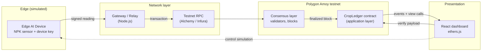
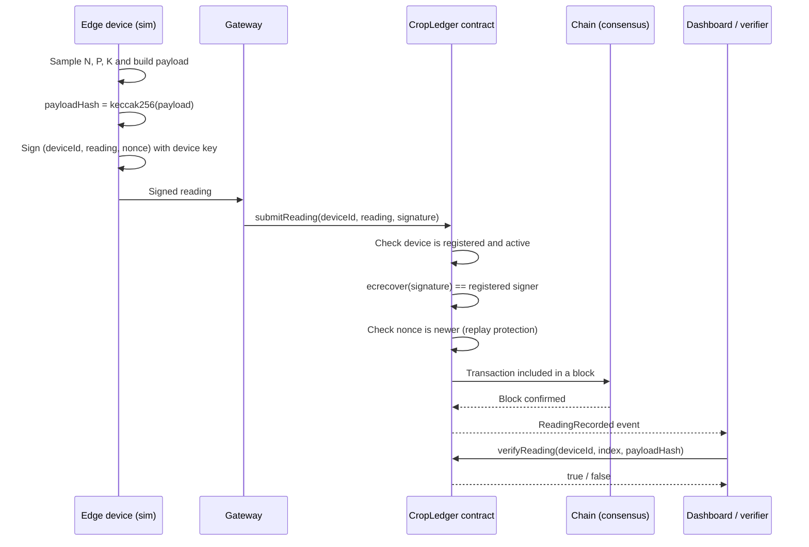

# CropLedger: Blockchain-Backed Evidence for Edge AI Crop-Field Data

**Blockchain Capstone Project**

A simulated edge AI device in a crop field streams soil nutrient (NPK) readings. Each reading is signed by the device and recorded in a smart contract deployed on a public testnet, so the data can later be used as tamper-proof, easy-to-retrieve evidence. A web dashboard visualizes the whole pipeline: device, network, block validation, and on-chain evidence lookup.

---

## Table of Contents

1. [Abstract](#1-abstract)
2. [Problem Statement](#2-problem-statement)
3. [Objectives](#3-objectives)
4. [Scope and Assumptions](#4-scope-and-assumptions)
5. [System Architecture](#5-system-architecture)
6. [Smart Contract Design](#6-smart-contract-design)
7. [Dashboard (UI) Design](#7-dashboard-ui-design)
8. [Tech Stack](#8-tech-stack)
9. [Evaluation Metrics](#9-evaluation-metrics)
10. [Future Work](#10-future-work)

---

## 1. Abstract

Precision agriculture increasingly relies on edge AI devices planted in the field. These devices measure soil nutrients such as nitrogen, phosphorus and potassium (NPK), and their readings influence fertilizer use, crop insurance claims, subsidy eligibility, and organic or quality certification. In a dispute, these readings are often the only objective evidence available, yet they usually live in a vendor-controlled database where records can be edited, deleted, or backdated after the fact, and where the other parties (farmer, insurer, buyer, regulator) cannot independently verify them.

CropLedger addresses this by anchoring field data on a blockchain. A simulated edge AI device generates NPK readings, signs each one with its device key, and submits it to a smart contract deployed on the Polygon Amoy testnet. The contract only accepts data from registered, non-revoked devices and stores a tamper-evident record of every reading (device, field, timestamp, NPK values, and a hash of the full payload). Anyone can later query the contract for a field's history and verify a reading against the chain without trusting the vendor's database.

The project is demonstrated through an interactive dashboard that visualizes the application layer (the deployed contract), the network layer (readings travelling from field to chain), and the consensus layer (transactions being batched into blocks and confirmed). The device side is simulated in software, so no physical hardware is required.

## 2. Problem Statement

Field sensor data is increasingly used to settle real financial and regulatory questions, but the infrastructure that stores it is not built to be trusted by everyone involved.

**Tamper-prone evidence.** Readings stored in a centralized database can be altered after a dispute arises. A farmer's proof of soil condition, or an insurer's counter-claim, cannot be accepted at face value by the other side.

**No verifiable source for each reading.** Nothing binds a reading to a specific registered device or to a known firmware version. Spoofed or manipulated sensor data is hard to tell apart from genuine data.

**Slow, manual evidence retrieval.** Assembling a verifiable history for a given field, device and time window means requesting records from a vendor and trusting what comes back.

**No shared source of truth between parties.** Farmers, insurers, buyers and regulators do not share a common record that none of them individually controls.

The problem this project solves is: *how can data transmitted by an edge AI device in a crop field be recorded so that it is tamper-proof, attributable to a specific registered device, and quickly retrievable as evidence by any interested party?*

## 3. Objectives

1. **Design and deploy a smart contract** on a public testnet (Polygon Amoy) that stores crop-field readings immutably and exposes read functions for evidence lookup.
2. **Establish device identity.** Implement an on-chain device registry so that only registered devices (bound to a field and a firmware hash) can write readings, and compromised devices can be revoked.
3. **Authenticate every reading.** Have each simulated device sign its readings, and verify the signature on-chain so a record is provably tied to its source.
4. **Build an edge device simulator** that generates realistic NPK time-series data, including configurable anomalies and tampering attempts, to drive the demo.
5. **Make evidence easy to retrieve and verify.** Provide queries by field, device and time range, and a verification function that recomputes a payload hash and checks it against the on-chain record.
6. **Visualize the blockchain layers.** Build a dashboard that shows the application layer live (deployed contract), and the network and consensus layers through a clear transaction-lifecycle view (pending, included in block, confirmed).
7. **Demonstrate tamper detection.** Show side by side that a genuine record verifies successfully while an altered record, an unregistered device, or a replayed message is rejected.
8. **Measure and report** gas cost per reading, confirmation latency, and query time, and discuss cost-reduction through batching.

## 4. Scope and Assumptions

- The edge device is **simulated**. Its signing key, firmware hash and readings are generated in software. The design maps directly onto a real device such as an ESP32 (which can sign data and compute SHA-256 on-chip), but no physical hardware is part of the deliverable.
- The contract is deployed on a **public testnet**. No real funds are involved.
- The primary blockchain layer is the **application layer**. The network and consensus layers are explained and visualized in the dashboard rather than re-implemented from scratch. Where real testnet block data is available it is used; validator animation is illustrative and labelled as such.
- Sensor accuracy is out of scope. The system guarantees the integrity and attribution of what a device reported, not that the sensor measured correctly.

## 5. System Architecture

### 5.1 Layered view

| Layer | Component | Role in CropLedger |
|---|---|---|
| Edge | Simulated edge AI device | Generates NPK readings, builds a payload, hashes and signs it with the device key |
| Network | Gateway / relay | Receives signed payloads from devices and forwards them to a testnet RPC node as transactions |
| Consensus | Polygon Amoy validators | Order and finalize transactions into blocks (visualized in the dashboard) |
| Application | `CropLedger` smart contract | Device registry, signature verification, reading storage, evidence queries |
| Presentation | React dashboard | Simulation control, live chain view, evidence search and verification |

### 5.2 Component diagram



### 5.3 Reading lifecycle



### 5.4 Data model

Each reading stores compact values on-chain plus a hash of the complete payload. The full payload (for example, extra metadata such as soil moisture or raw model output) stays off-chain, and its hash on-chain proves it has not been altered.

| Field | Type | Description |
|---|---|---|
| `deviceId` | `bytes32` | Identifier of the registered device |
| `fieldId` | `bytes32` | Field the device is assigned to |
| `timestamp` | `uint64` | Time of the reading |
| `n`, `p`, `k` | `uint16` | NPK values (for example mg/kg) |
| `payloadHash` | `bytes32` | `keccak256` of the full payload |
| `nonce` | `uint64` | Strictly increasing per device, prevents replay |

### 5.5 Security model

| Threat | Mitigation |
|---|---|
| Records edited after a dispute | Chain immutability; verification recomputes the hash and compares |
| Data from an unknown or fake device | Device registry; only registered signers are accepted |
| Message forged on behalf of a device | Signature verified on-chain with `ecrecover` |
| Old valid message resubmitted | Per-device nonce must strictly increase |
| Compromised device key | Owner can revoke the device; later submissions are rejected |
| Device running modified firmware | Firmware hash recorded at registration, available for audit |
| Gateway tampering with data | Gateway cannot alter a payload without invalidating the device signature |

## 6. Smart Contract Design

Interface sketch (Solidity):

```solidity
struct Device {
    address signer;        // public key (address) the device signs with
    bytes32 fieldId;       // field this device is bound to
    bytes32 firmwareHash;  // SHA-256 of the firmware at registration
    uint64  lastNonce;     // replay protection
    bool    active;
}

struct Reading {
    uint64  timestamp;
    uint16  n;
    uint16  p;
    uint16  k;
    bytes32 payloadHash;
}

// Admin
function registerDevice(bytes32 deviceId, address signer, bytes32 fieldId, bytes32 firmwareHash) external onlyOwner;
function revokeDevice(bytes32 deviceId) external onlyOwner;

// Write
function submitReading(bytes32 deviceId, Reading calldata r, uint64 nonce, bytes calldata signature) external;

// Read / evidence
function getReadingCount(bytes32 deviceId) external view returns (uint256);
function getReading(bytes32 deviceId, uint256 index) external view returns (Reading memory);
function verifyReading(bytes32 deviceId, uint256 index, bytes32 payloadHash) external view returns (bool);

// Events (used for cheap history queries by field, device and time)
event DeviceRegistered(bytes32 indexed deviceId, bytes32 indexed fieldId, address signer);
event DeviceRevoked(bytes32 indexed deviceId);
event ReadingRecorded(bytes32 indexed deviceId, bytes32 indexed fieldId, uint256 index, uint64 timestamp);
```

Design notes:

- **Events for history.** Per-field and per-time-range queries are served from indexed events, which are cheaper than iterating storage.
- **Gas cost.** Submitting every reading as its own transaction is simple and good for a live demo. A batching mode (a Merkle root of many readings submitted in one transaction, with per-reading proofs checked later) is described under Future Work as the production-scale option.
- **Access control.** Registration and revocation are restricted to the contract owner (for example a cooperative, regulator or platform operator).

## 7. Dashboard (UI) Design

| View | What it shows |
|---|---|
| Simulation control | Start or stop devices, set reading frequency, inject anomalies, tampering, replays, or an unregistered device |
| Live device feed | NPK values streaming from each simulated device, with signature status |
| Transaction lifecycle | Each reading moving through pending, included in block, and confirmed, with block number and transaction hash linked to the testnet explorer |
| Chain view | Recent blocks and the transactions in them, with a consensus visualization (proposer, validator confirmations) labelled as illustrative |
| Evidence search | Query by field, device and time range; table and chart of on-chain readings |
| Verify record | Upload or paste a payload, recompute its hash, and show a clear verified or tampered result against the chain |
| Device registry | Registered devices, assigned fields, firmware hashes, and revocation status |

The most important demo flow: run the simulator, show readings landing on-chain, then alter one payload and show verification failing while the original still passes.

## 8. Tech Stack

| Area | Choice |
|---|---|
| Blockchain | Polygon Amoy testnet (EVM-compatible, free test tokens, public explorer) |
| Smart contract | Solidity, Hardhat, OpenZeppelin (`Ownable`, `ECDSA`) |
| Edge simulator and gateway | Node.js with ethers.js |
| Dashboard | React, ethers.js, a charting library (for example Recharts) |
| RPC provider | Alchemy or Infura free tier |
| Testing | Hardhat tests for registry, signatures, replay and revocation |

## 9. Evaluation Metrics

- **Integrity:** every tampered payload, replayed message, unregistered-device submission, and revoked-device submission is rejected or flagged (target: 100% in the test suite).
- **Cost:** gas used per reading, and projected cost for a day of readings at a chosen sampling rate.
- **Latency:** time from device submission to confirmed block.
- **Retrieval:** time to return a field's history for a given range through the dashboard.
- **Scalability discussion:** cost comparison of per-reading submission versus Merkle-batched submission.

## 10. Future Work

- Run the same signing and verification flow on a physical ESP32, using its hardware SHA/crypto support.
- Merkle-batched submission to reduce gas cost at scale.
- Off-chain storage of full payloads (for example IPFS) referenced by the on-chain hash.
- Multi-party access control so insurers, buyers and regulators have read-only audit roles.
- Automated claim logic, for example an insurance payout condition triggered by verified readings.
- Trusted-execution or attestation support to strengthen the guarantee that a reading was genuinely produced by the device.
