# CropLedger

**Blockchain-backed evidence for edge AI crop-field data.**

[](https://github.com/Roots26Hz/CropLedger/actions/workflows/ci.yml)

CropLedger is an end-to-end blockchain application for recording, authenticating and verifying crop-field sensor readings. It uses Solidity, React, MetaMask and the Polygon Amoy testnet. A simulated edge device signs soil nutrient readings (N, P, K). A Solidity smart contract accepts them only from registered devices and stores them so they are tamper-evident. A React dashboard lets anyone retrieve the history, verify a reading and watch tampering, replays and forged data being rejected.

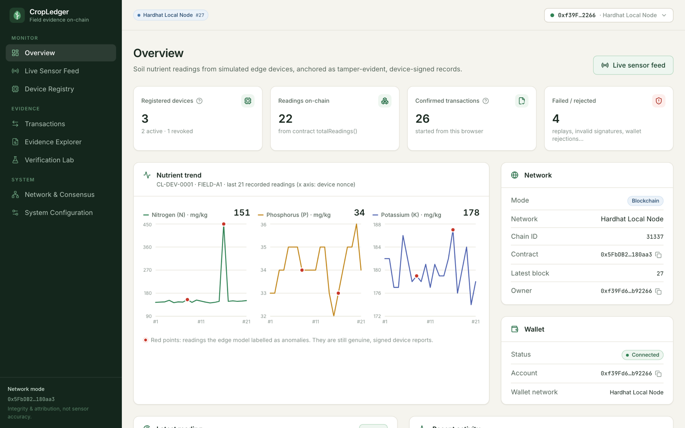

<sub>Screenshot of the running app connected to a local Hardhat chain (real transactions and blocks). See [Screenshots](#screenshots).</sub>

---

## Table of contents

1. [Problem statement](#1-problem-statement)
2. [Objectives](#2-objectives)
3. [Key features](#3-key-features)
4. [Architecture](#4-architecture)
5. [Technology stack](#5-technology-stack)
6. [Project structure](#6-project-structure)
7. [Prerequisites](#7-prerequisites)
8. [Installation](#installation)
9. [Environment configuration](#9-environment-configuration)
10. [Running the dashboard](#10-running-the-dashboard)
11. [Running the edge simulator (CLI)](#11-running-the-edge-simulator-cli)
12. [Automated tests](#12-automated-tests)
13. [Local demonstration mode](#13-local-demonstration-mode)
14. [Deploying with Remix IDE](#14-deploying-with-remix-ide)
15. [Connecting MetaMask](#15-connecting-metamask)
16. [Deploying to Polygon Amoy](#16-deploying-to-polygon-amoy)
17. [Connecting the dashboard to your contract](#17-connecting-the-dashboard-to-your-contract)
18. [Demo: successful reading](#18-demo-successful-reading)
19. [Demo: tamper detection](#19-demo-tamper-detection)
20. [Security considerations](#20-security-considerations)
21. [Known limitations](#21-known-limitations)
22. [Future improvements](#22-future-improvements)
23. [Documentation, report and presentation](#23-documentation-report-and-presentation)
24. [Screenshots](#screenshots)
25. [License](#25-license)
26. [Authors and contributors](#26-authors-and-contributors)

---

## 1. Problem statement

Soil nutrient readings from field sensors increasingly decide fertiliser use, crop-insurance claims, subsidies and certification. These readings usually live in a centralised, vendor-controlled database. There a record can be edited, deleted or back-dated after a dispute begins, nothing ties a reading to a specific registered device, and farmers, insurers and regulators share no record that none of them controls.

**How can readings from an edge device be recorded so that they are tamper-evident, attributable to a registered device, and quickly retrievable as evidence by anyone?**

The original proposal is kept in [`CropLedger_README.md`](CropLedger_README.md).

## 2. Objectives

1. A Solidity smart contract on Polygon Amoy that stores readings immutably and serves evidence queries.
2. An on-chain device registry (field and firmware hash per device) with revocation.
3. A device signature on every reading, verified on-chain (EIP-712 + OpenZeppelin ECDSA), with replay protection.
4. A realistic edge-device simulator, including anomalies and attack attempts.
5. Fast evidence retrieval and hash-based verification of any stored reading.
6. A dashboard that visualises the application, network and consensus layers and demonstrates tamper detection.

## 3. Key features

- **Smart contract** (`CropLedger.sol`): owner-controlled registration, revocation and firmware updates; EIP-712 signature verification; strictly increasing per-device nonces; input validation; compact two-slot storage; `verifyReading`; events; custom errors.
- **Edge simulator**: realistic N/P/K, moisture, temperature and pH with diurnal variation; spike, drift and dropout anomaly injection; an on-device rolling z-score anomaly model ("edge AI"); canonical, deterministic payloads.
- **Gateway**: validates, preflights with `eth_call` (rejections cost no gas), broadcasts, and reports *submitted* → *confirmed* only once a receipt arrives. It decodes custom errors, including the reason behind mined-but-reverted transactions.
- **Dashboard** (8 pages): Overview, Live Sensor Feed, Device Registry, Transactions, Evidence Explorer, Verification Lab (integrity workflow and attack scenarios), Network & Consensus, System Configuration.
- **MetaMask**: connect/disconnect, EIP-6963 wallet discovery, account and network display, wrong-network detection with one-click switching, plain-language error messages. The app never asks for keys.
- **Two clearly separated modes**: real blockchain (Polygon Amoy or a local Hardhat chain), or an in-browser **local demonstration mode** that applies the same rules (checked by a parity test) without pretending to be a blockchain.
- **Safety rails**: only chain IDs 80002 (Amoy) and 31337 (Hardhat) are allowed, mainnets are refused, no secrets in the frontend, and RPC URLs are masked.
- **105 automated tests**, plus linting, type checks and CI.

## 4. Architecture

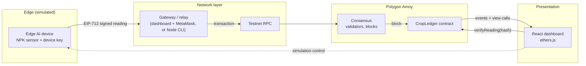

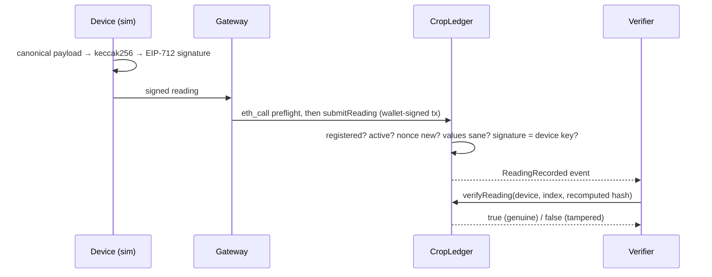

The details (payload schema, signing domain, storage layout, lifecycle states, modes) are in [docs/ARCHITECTURE.md](docs/ARCHITECTURE.md).

## 5. Technology stack

| Area | Technology (version) |
|---|---|
| Smart contract | Solidity **0.8.34** (EVM `cancun`, optimizer 200 runs), OpenZeppelin Contracts **5.6.1** (`Ownable2Step`, `EIP712`, `ECDSA`) |
| Contract IDE (demonstration) | **Remix IDE** (web) |
| Testnet | **Polygon Amoy** (chain ID 80002, gas token POL) |
| Wallet | **MetaMask** (EIP-1193 / EIP-6963), any current version |
| Development & tests | **Hardhat 3.20** (mocha + ethers toolbox), Mocha, Chai |
| Blockchain library | **ethers.js 6.17** |
| Simulator / gateway / CLI | Node.js + TypeScript (`tsx`) |
| Frontend | **React 19.3**, **Vite 8.3**, **TypeScript 6.0**, **Tailwind CSS 4.3**, **Recharts 3.10**, lucide-react |
| Unit tests | **Vitest 5** |
| Quality | ESLint 10 (typescript-eslint, React Hooks), GitHub Actions |
| Runtime | **Node.js 24** (`.nvmrc`; ≥ 22.12 supported), **npm ≥ 10** (tested with 11.13) |

## 6. Project structure

```
CropLedger/
├── contracts/CropLedger.sol        Solidity contract (shown in Remix)
├── abi/CropLedger.json             ABI used by the simulator and dashboard
├── simulator/                      shared core (Node + browser)
│   ├── payload.ts                  canonical payload, hashing, validation
│   ├── signing.ts                  EIP-712 signing scheme
│   ├── deviceSimulator.ts          edge device + anomaly model
│   ├── gateway.ts                  validate → preflight → send → confirm
│   ├── localLedger.ts              contract rules for local demo mode
│   ├── networks.ts, errors.ts, ids.ts, serialization.ts, abi.ts, types.ts
│   ├── cli.ts                      `npm run sim` command-line tool
│   └── __tests__/                  Vitest unit tests
├── scripts/
│   ├── deploy-local.ts             deploy to `npm run node`
│   ├── deploy-testnet.ts           optional CLI deployment to Amoy
│   └── export-abi.ts               ABI export / drift check
├── test/                           Hardhat tests (contract, gateway, parity)
├── frontend/                       React dashboard (npm workspace)
│   └── src/{components,pages,hooks,services,state,types,utils,config}
├── docs/
│   ├── ARCHITECTURE.md  SECURITY.md  DEMO_GUIDE.md
│   └── screenshots/                real screenshots of the app
├── report/
│   ├── REPORT.md                   synopsis source (editable)
│   ├── build_report.py             PDF generator
│   └── CropLedger_Synopsis.pdf     ≤ 5-page synopsis
├── REMIX_DEPLOYMENT_GUIDE.md  ORAL_PRESENTATION_GUIDE.md  TESTING.md
├── .github/workflows/ci.yml
├── hardhat.config.ts  vitest.config.ts  eslint.config.js  tsconfig.json
├── package.json  package-lock.json  .nvmrc  .env.example  LICENSE
└── CropLedger_README.md            original project proposal
```

## 7. Prerequisites

- **Node.js 24 LTS** (or ≥ 22.12) and **npm ≥ 10**. With nvm: `nvm use`.
- **Git**.
- For the blockchain demo: a Chromium-based browser or Firefox with **MetaMask**, a **testnet-only** account, and **Amoy test POL** from a faucet.
- Nothing else: Hardhat downloads the Solidity compiler automatically, and Remix runs in the browser.

## Installation

From the repository root (this installs the root project **and** the `frontend` workspace):

```bash
git clone https://github.com/Roots26Hz/CropLedger.git
cd CropLedger
npm install
```

Use `npm ci` for an exact reproduction of `package-lock.json` (as CI does).

## 9. Environment configuration

Optional. Without a `.env` the dashboard starts in local demonstration mode.

```bash
cp .env.example .env
```

| Variable | Used by | Public? | Purpose |
|---|---|---|---|
| `VITE_CHAIN_ID` | dashboard | yes | `80002` (Amoy) or `31337` (Hardhat). Others are refused. |
| `VITE_CONTRACT_ADDRESS` | dashboard | yes | Your deployed CropLedger address. Empty → local demo mode. |
| `VITE_RPC_URL` | dashboard | yes | Read-only RPC (default `https://rpc-amoy.polygon.technology`). |
| `VITE_DEPLOY_BLOCK` | dashboard | yes | Deployment block (optional). |
| `AMOY_RPC_URL` | Hardhat, CLI | server-side | RPC for `deploy:amoy` and `sim --network amoy`. |
| `DEPLOYER_PRIVATE_KEY` | `deploy:amoy`, `sim register` | **secret** | Testnet-only deployer/owner. Prefer `npx hardhat keystore set DEPLOYER_PRIVATE_KEY`. |
| `GATEWAY_PRIVATE_KEY` | `sim run/attack` on Amoy | **secret** | Testnet-only account that pays gas for the CLI gateway. |
| `OWNER_ADDRESS` | deploy scripts | yes | Owner to set at deployment (e.g. your MetaMask address). |

`VITE_*` values are compiled into the browser bundle: never put keys there. `.env` is gitignored. Remix deployment needs **no** `.env` keys at all.

## 10. Running the dashboard

```bash
npm run dev          # http://localhost:5173
```

Production build and preview:

```bash
npm run build
npm run preview      # http://localhost:4173
```

## 11. Running the edge simulator (CLI)

The CLI simulates devices and acts as a Node gateway. Device keys are stored in `.simulator/devices.json` (gitignored).

```bash
npm run sim -- help
npm run sim -- device:create --id CL-DEV-0001 --field FIELD-A1
npm run sim -- generate --device CL-DEV-0001 --count 10 --anomaly spike    # offline dry run
```

Against a **local Hardhat chain** (real transactions on your machine):

```bash
npm run node                                         # terminal 1
npm run deploy:local                                 # terminal 2
npm run sim -- register --device CL-DEV-0001
npm run sim -- run --device CL-DEV-0001 --count 5 --interval 2
npm run sim -- attack replay --device CL-DEV-0001
npm run sim -- attack unregistered --device CL-DEV-0001
npm run sim -- attack forged --device CL-DEV-0001
npm run sim -- verify --payload .simulator/payloads/<dir>/CL-DEV-0001-nonce-1.json --index 0
```

Against **Amoy**, add `--network amoy --contract 0x…` (needs `GATEWAY_PRIVATE_KEY`, plus `DEPLOYER_PRIVATE_KEY` for `register`). To print Remix-ready arguments, run `npm run sim -- remix-args --device CL-DEV-0001 --contract 0x… --chain-id 80002`.

## 12. Automated tests

```bash
npm test               # all: Hardhat (49) + Vitest (56)
npm run test:contracts # contract, gateway and local-mode parity tests
npm run test:unit      # payload, signing, simulator, networks, frontend services
npm run typecheck
npm run lint
npm run abi:check
```

The contract tests sign every reading with the project's own TypeScript signer, so they prove the off-chain signing matches on-chain verification. They also print the measured gas use. See [TESTING.md](TESTING.md) for the full test list and actual results.

## 13. Local demonstration mode

When no contract is configured, or after choosing *Local demonstration* in System Configuration, the dashboard runs an in-browser copy of the contract rules:

- Readings are generated, hashed and EIP-712-signed for real. Signature, replay, revocation and tamper checks run with the same logic as the contract (`test/parity.test.ts` proves identical outcomes).
- It is clearly labelled: an amber banner, `LOCAL-000001` references instead of transaction hashes, *simulated block* numbers, no explorer links, no gas, and a signing domain (chain ID 0) that no real contract accepts.
- It never switches on by itself after a network error.

Features that need a real deployment: transaction hashes, receipts and confirmations, explorer links, gas, real blocks, and public verifiability.

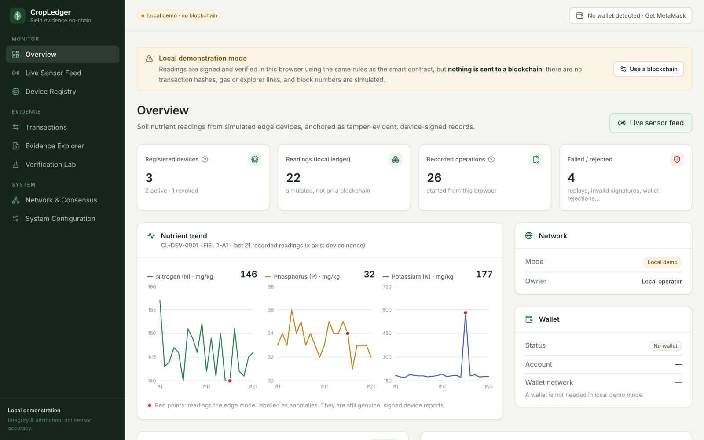

## 14. Deploying with Remix IDE

The Solidity source is demonstrated in **Remix IDE**. The short version:

1. Open <https://remix.ethereum.org/> → new workspace → upload `contracts/CropLedger.sol` (or open `https://remix.ethereum.org/#url=https://github.com/Roots26Hz/CropLedger/blob/main/contracts/CropLedger.sol`).
2. Solidity Compiler: **0.8.34**, EVM **cancun**, optimization **200** → *Compile*.
3. Deploy & Run: Environment **Injected Provider – MetaMask** (on Amoy), constructor `initialOwner` = your address → *Deploy* → confirm.
4. Copy the deployed address, then check the transaction on `https://amoy.polygonscan.com`.

Full step-by-step instructions, including registering a device, submitting a signed reading from Remix, verifying it and showing rejections, are in **[REMIX_DEPLOYMENT_GUIDE.md](REMIX_DEPLOYMENT_GUIDE.md)**.

## 15. Connecting MetaMask

1. Install MetaMask and create or import a **testnet-only** account.
2. In the dashboard click **Connect wallet**. The account and network appear in the top bar.
3. If MetaMask is on another network, click **Switch to Amoy**. The dashboard asks MetaMask to switch, and to add Amoy if needed (RPC `https://rpc-amoy.polygon.technology`, chain ID 80002, POL, explorer `https://amoy.polygonscan.com`).
4. Get test POL from the [Polygon faucet](https://faucet.polygon.technology/) or another Amoy faucet (subject to availability).

Every write (register, revoke, submit) opens a MetaMask approval. Rejecting is handled gracefully, and nothing is sent.

## 16. Deploying to Polygon Amoy

- **Recommended:** Remix + MetaMask, as in [REMIX_DEPLOYMENT_GUIDE.md](REMIX_DEPLOYMENT_GUIDE.md).
- **Optional CLI:** set `AMOY_RPC_URL` and a testnet-only `DEPLOYER_PRIVATE_KEY` (keystore or `.env`), then:
  ```bash
  npm run deploy:amoy
  ```
  The script refuses any chain other than 80002, checks the balance, waits for 2 confirmations and prints explorer links.

> **No public Amoy deployment has been made by the authors yet.** There is no official contract address in this repository; use your own.

## 17. Connecting the dashboard to your contract

Remix does not talk to the dashboard. Copy the address yourself:

- **System Configuration** → Network *Polygon Amoy* → paste the address (and deployment block) → **Save settings** → **Run checks**, or
- set `VITE_CHAIN_ID=80002`, `VITE_CONTRACT_ADDRESS=0x…` and `VITE_DEPLOY_BLOCK` in `.env`, then restart `npm run dev`.

The ABI ships as [`abi/CropLedger.json`](abi/CropLedger.json), generated from the same source. Only if you modify the contract do you need to regenerate it (`npm run export-abi`) or paste Remix's ABI into that file; `npm run abi:check` and the tests catch any mismatch. The diagnostics also compare the deployed contract's EIP-712 domain and `READING_TYPEHASH` with the frontend's signing format.

## 18. Demo: successful reading

1. Device Registry → **Generate key & register** (owner account) → approve.
2. Live Sensor Feed → **One reading** → **Submit** → approve. The status moves *Preflight → Awaiting wallet → Pending → Confirmed* and shows the block number.
3. Click **Tx**, which opens the Amoy explorer.
4. Evidence Explorer → **Retrieve history** → **Inspect**.
5. Verification Lab → **Verify original** → **VERIFIED**.

## 19. Demo: tamper detection

1. Verification Lab → select a recorded reading → **Verify original** → *VERIFIED*.
2. In *Altered copy* change one value (e.g. N 145 → 170). The new hash differs in almost every character, and the signature no longer matches.
3. **Verify altered copy** → **TAMPERING DETECTED**. `verifyReading` returned `false`.
4. Attack scenarios: **Replay** → `StaleNonce`, **Unregistered device** → `UnknownDevice`, **Gateway forgery** → `InvalidSignature`, **Revoked device** → `DeviceNotActive`, with history kept.

All six scenarios with expected outputs are in [docs/DEMO_GUIDE.md](docs/DEMO_GUIDE.md).

## 20. Security considerations

- The contract enforces every security rule: the device registry, signature recovery to the registered key, the EIP-712 domain (chain and contract), strictly increasing nonces, input bounds, and `Ownable2Step` access control. The frontend and gateway checks only give earlier, clearer errors.
- No private keys or seed phrases are requested, stored or displayed. MetaMask signs all transactions. Optional CLI keys stay server-side (Hardhat keystore or gitignored `.env`).
- Only Amoy and local Hardhat chains are allowed.
- **The system protects the integrity and attribution of recorded readings, not the physical accuracy of the sensor.**

Read [docs/SECURITY.md](docs/SECURITY.md) for the full threat model and trust assumptions.

## 21. Known limitations

- Sensor accuracy cannot be proven on-chain, and devices are simulated.
- Simulated device keys are stored in the browser's `localStorage` (or `.simulator/` for the CLI), not in secure hardware.
- One transaction per reading: simple, but costly at scale.
- Full payloads are stored off-chain by whoever generated them. The dashboard keeps them per browser and supports export and import.
- The owner is a single account (use a multisig in practice).
- **Not yet verified on a public testnet.** Everything was tested on Hardhat (in-process and `npm run node`). MetaMask popups were not automated: the wallet path was exercised with an EIP-1193 test shim. See [TESTING.md](TESTING.md#6-known-limitations).

## 22. Future improvements

- Firmware on a real ESP32 with a secure element (ATECC608) and firmware attestation.
- Merkle-batched submissions to cut gas costs.
- Full payloads on IPFS/Filecoin, referenced by the on-chain hash.
- Multisig or DAO ownership, plus read-only audit roles for insurers and regulators.
- Automated insurance-claim logic driven by verified readings.
- An event indexer (e.g. The Graph) for large histories.
- Playwright end-to-end tests with a wallet test harness.

## 23. Documentation, report and presentation

| Document | Purpose |
|---|---|
| [REMIX_DEPLOYMENT_GUIDE.md](REMIX_DEPLOYMENT_GUIDE.md) | Remix → MetaMask → Amoy workflow, ABI/address transfer, register/submit/verify |
| [ORAL_PRESENTATION_GUIDE.md](ORAL_PRESENTATION_GUIDE.md) | 5-minute script, concepts, viva questions and answers |
| [docs/DEMO_GUIDE.md](docs/DEMO_GUIDE.md) | Six demonstration scenarios with expected outputs |
| [docs/ARCHITECTURE.md](docs/ARCHITECTURE.md) | Design, data formats, contract internals |
| [docs/SECURITY.md](docs/SECURITY.md) | Threat model, trust assumptions, secret handling |
| [TESTING.md](TESTING.md) | Test commands, cases and actual results |
| [report/CropLedger_Synopsis.pdf](report/CropLedger_Synopsis.pdf) | Synopsis report (≤ 5 pages); source in [report/REPORT.md](report/REPORT.md) |
| [CropLedger_README.md](CropLedger_README.md) | Original proposal |

There is no PowerPoint: the project is presented live from Remix and the dashboard.

## Screenshots

These are real captures of the running application, nine of them against a local Hardhat chain:

| | |
|---|---|
| 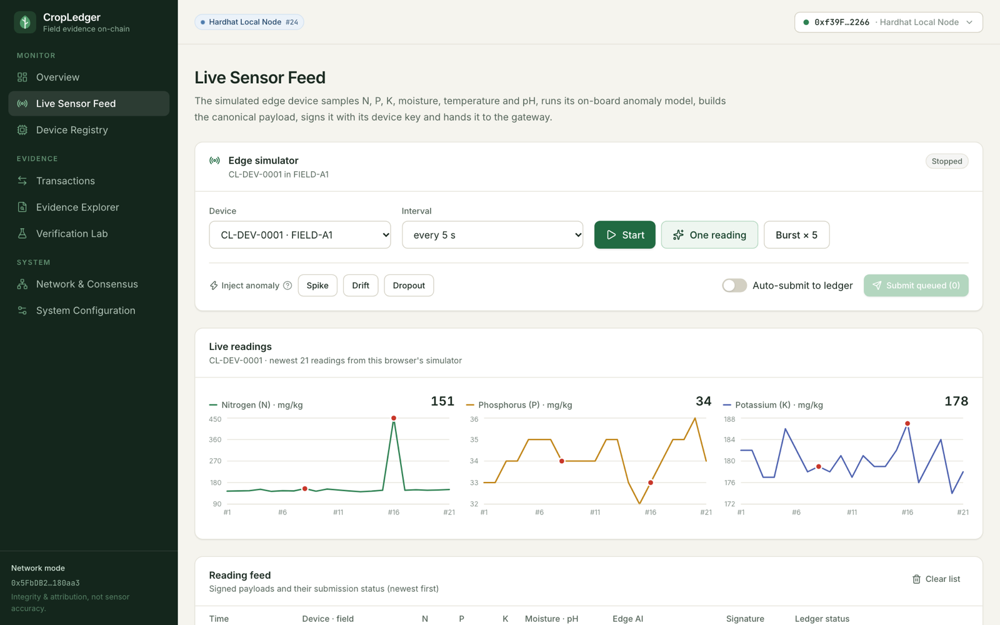 Live Sensor Feed — a spike flagged by the edge model | 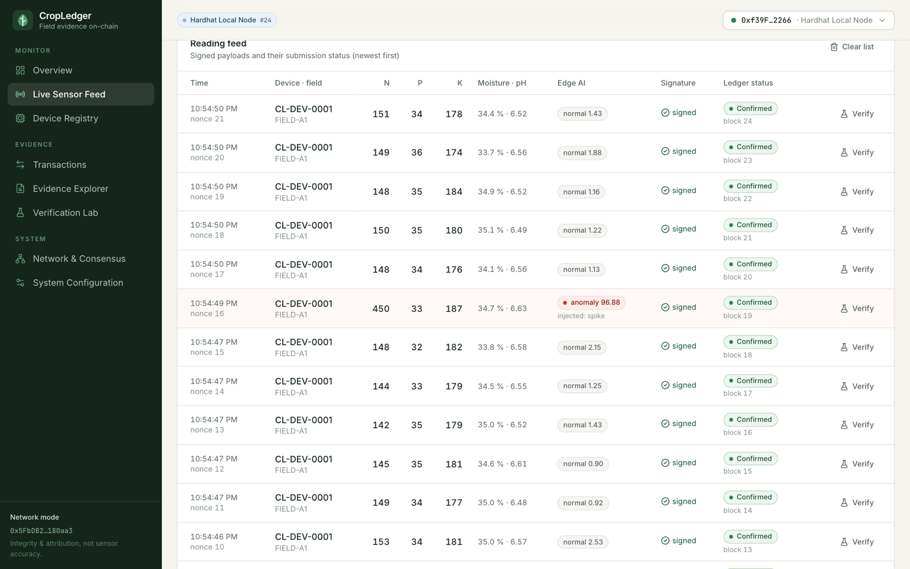 Signed readings with on-chain status |
| 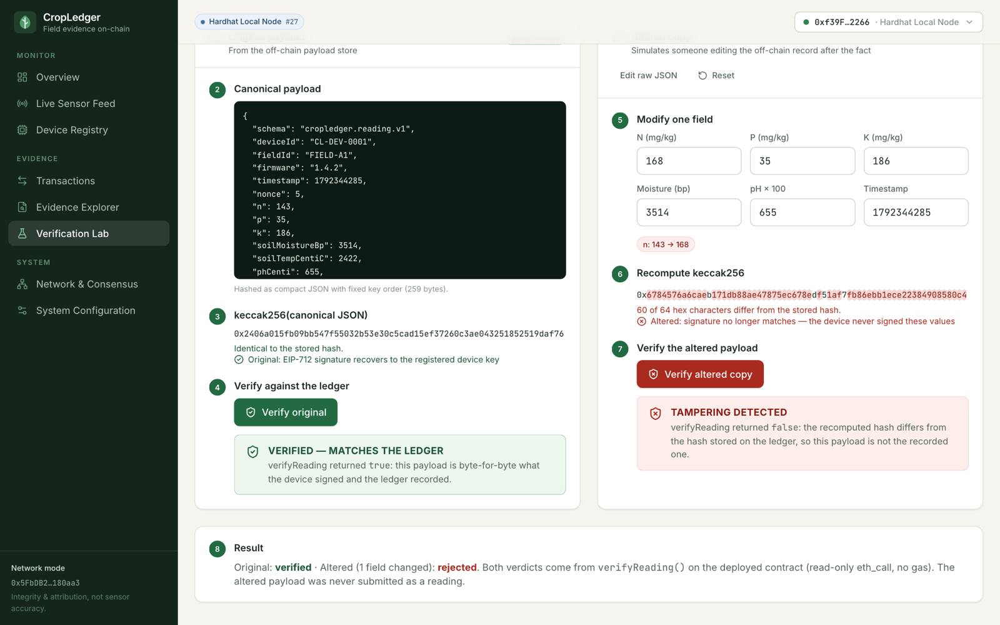 Verification Lab — genuine vs altered | 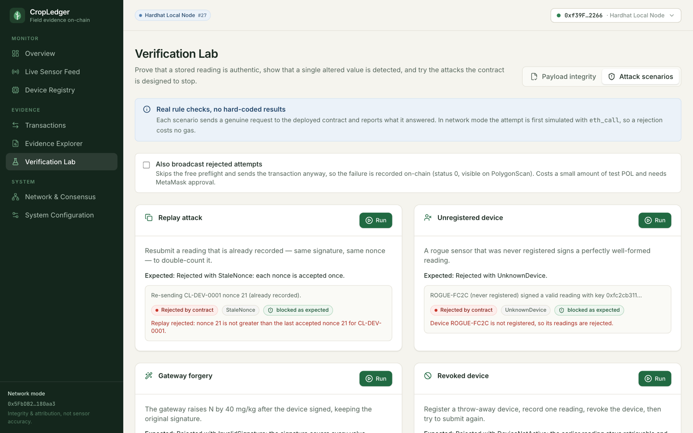 Attack scenarios rejected by the contract |
| 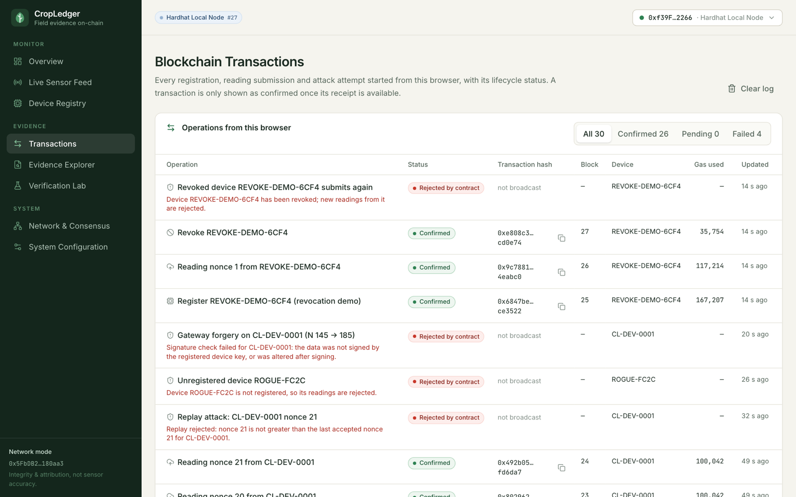 Transactions and their lifecycle | 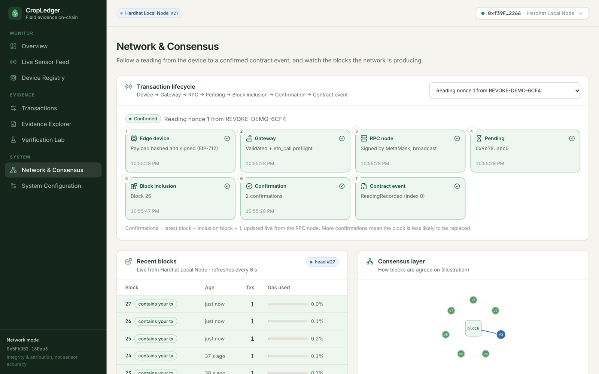 Lifecycle trace, recent blocks, illustrative consensus |
| 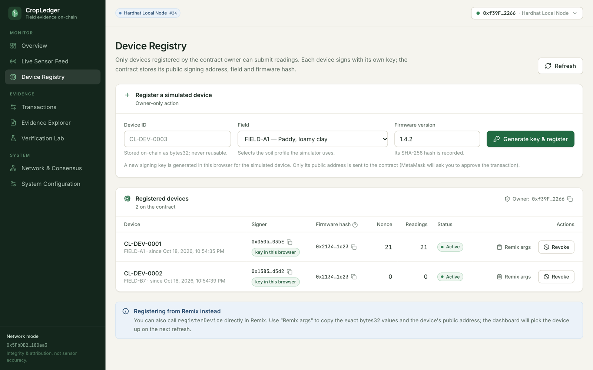 Device registry | 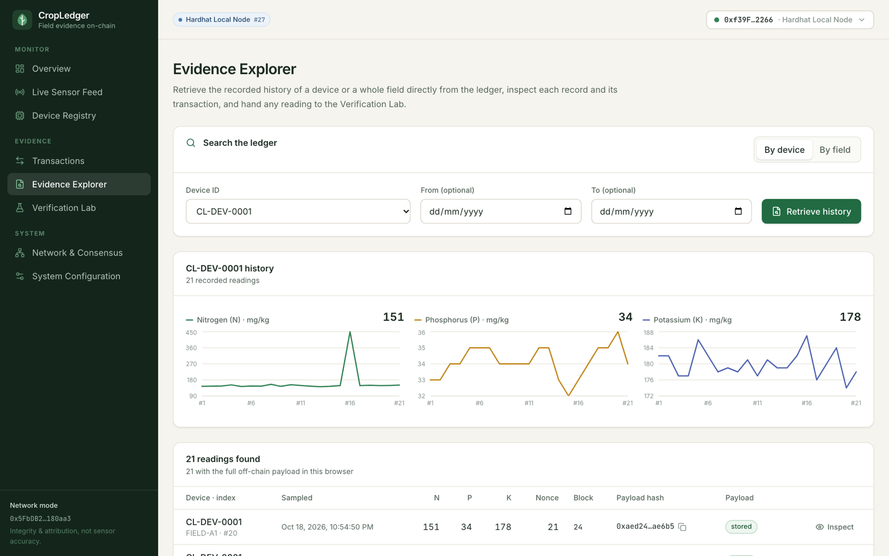 Evidence explorer |

Screenshots of the Polygon Amoy deployment are not included yet. Add them to `docs/screenshots/` after you complete the Remix deployment.

## 25. License

[MIT](LICENSE). The copyright holder line is a placeholder: replace `[Copyright Holder]` with your name.

## 26. Authors and contributors

- **[Author name]**: *[Roll number / course: 23CSE335 Blockchain]*
- **[Contributor name]**: *[role]*

Repository: <https://github.com/Roots26Hz/CropLedger>
