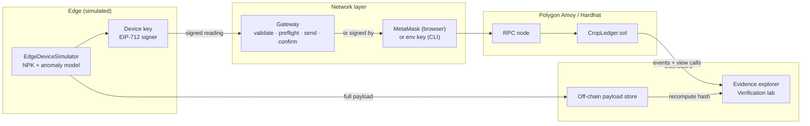
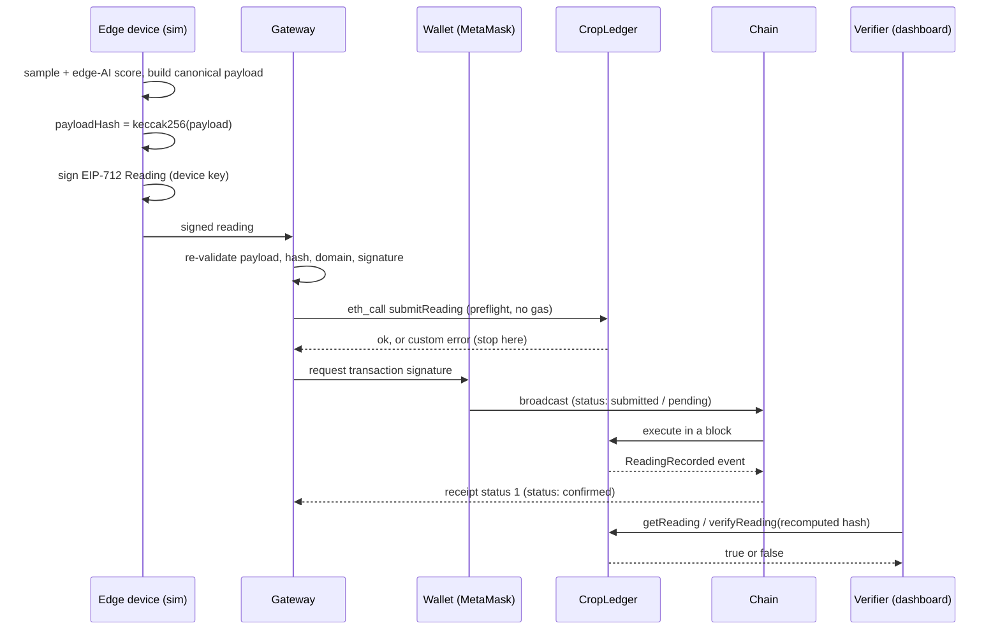

# CropLedger Architecture

This document describes how CropLedger is built: the layers, the data formats that must match exactly between the device, the gateway and the contract, the smart-contract design, and the two operating modes of the dashboard.

## 1. Layers

| Layer | Component | Code | Responsibility |
|---|---|---|---|
| Edge | Simulated edge AI device | [`simulator/deviceSimulator.ts`](../simulator/deviceSimulator.ts) | Samples N, P, K, moisture, temperature, pH; runs a rolling z-score anomaly model; builds the canonical payload; increments the nonce |
| Edge | Device identity & signing | [`simulator/signing.ts`](../simulator/signing.ts), [`simulator/payload.ts`](../simulator/payload.ts) | Hashes the payload (keccak256) and signs an EIP-712 `Reading` with the device key |
| Network | Gateway / relay | [`simulator/gateway.ts`](../simulator/gateway.ts) | Validates the signed reading, preflights with `eth_call`, broadcasts, waits for the receipt, decodes errors |
| Consensus | Polygon PoS (Amoy) or Hardhat | external | Orders transactions into blocks; the dashboard only *observes* this |
| Application | `CropLedger` contract | [`contracts/CropLedger.sol`](../contracts/CropLedger.sol) | Device registry, signature verification, replay protection, storage, evidence queries, events |
| Presentation | React dashboard | [`frontend/src`](../frontend/src) | Wallet, simulation control, transactions, evidence retrieval, verification and attack labs |

The `simulator/` folder is a framework-free TypeScript library used by **three** consumers: the Hardhat tests, the Node CLI (`npm run sim`) and the browser dashboard (imported as `@core/*`). The signing code that the dashboard runs is therefore the same code the contract tests verify.



## 2. Canonical payload (off-chain)

Schema `cropledger.reading.v1`, all numbers integers (fractions are scaled), fixed key order, no whitespace:

```json
{"schema":"cropledger.reading.v1","deviceId":"CL-DEV-0001","fieldId":"FIELD-A1","firmware":"1.4.2","timestamp":1760000000,"nonce":1,"n":142,"p":38,"k":191,"soilMoistureBp":2345,"soilTempCentiC":2410,"phCenti":652,"anomalyScoreMilli":120,"anomalyLabel":"normal"}
```

| Key | Meaning | Unit / range |
|---|---|---|
| `deviceId`, `fieldId` | Human-readable IDs, stored on-chain as `bytes32` (`encodeBytes32String`) | 1–31 chars `[A-Za-z0-9._:-]` |
| `firmware` | Firmware version string | printable ASCII |
| `timestamp` | Sampling time | Unix seconds |
| `nonce` | Per-device counter | ≥ 1, strictly increasing |
| `n`, `p`, `k` | Nutrients | mg/kg, 0–10 000 |
| `soilMoistureBp` | Volumetric moisture | basis points (2345 = 23.45 %) |
| `soilTempCentiC` | Soil temperature | hundredths of °C |
| `phCenti` | pH | pH × 100 |
| `anomalyScoreMilli` | Edge-AI score | max |z| × 1000 |
| `anomalyLabel` | Edge-AI label | `normal` / `anomaly` |

`payloadHash = keccak256(utf8(canonicalJson))`. Validation rejects missing or unknown keys, non-integers and out-of-range values, so no ambiguous encoding can produce a second "valid" byte string for the same reading.

The full payload stays off-chain (in the dashboard's browser store or `.simulator/payloads/` for the CLI) — it plays the role of the vendor database. The chain stores the hash plus compact values.

## 3. Signing scheme (EIP-712)

```
Domain:  { name: "CropLedger", version: "1", chainId, verifyingContract }
Type:    Reading(bytes32 deviceId,bytes32 fieldId,uint64 timestamp,
                 uint16 n,uint16 p,uint16 k,uint64 nonce,bytes32 payloadHash)
```

- The device signs `TypedDataEncoder.hash(domain, types, message)` (ethers `signTypedData`).
- The contract rebuilds the same struct — **taking `fieldId` from its registry**, not from the caller — and recovers the signer with OpenZeppelin `ECDSA.tryRecover` over `_hashTypedDataV4`.
- `READING_TYPEHASH()` and `readingDigest(...)` are public so off-chain code can cross-check; the test suite asserts the TypeScript digest equals the contract digest, and the dashboard's diagnostics compare `READING_TYPEHASH` before use.
- Domain separation (chain ID + contract address) stops signatures being replayed on another network or deployment; `deviceId`, `fieldId` and `nonce` stop reuse across devices, fields and submissions. Local demo mode signs with chain ID 0 and the zero address, so demo signatures can never be accepted by a real contract.

## 4. Smart contract

`CropLedger is Ownable2Step, EIP712` (OpenZeppelin 5.6.1, solc 0.8.34, EVM `cancun`, optimizer 200 runs).

### Storage

| Item | Layout |
|---|---|
| `Device` | `signer` (20 B) + `lastNonce` (uint64) + `active` → slot 0; `registeredAt`, `revokedAt` (uint64) → slot 1; `fieldId`; `firmwareHash` |
| `ReadingRecord` | `timestamp` (uint64) + `n`,`p`,`k` (uint16) + `nonce` (uint64) + `blockNumber` (uint64) = 30 bytes → slot 0; `payloadHash` → slot 1 |
| Indexes | `mapping(bytes32 => Device)`, `mapping(bytes32 => ReadingRecord[])`, `bytes32[] _deviceIds`, `mapping(address => bytes32) deviceIdOfSigner`, `uint256 totalReadings` |

Storing `blockNumber` with each reading lets clients find the recording transaction with a single-block log query, which is cheap and works on rate-limited public RPCs.

### Functions

| Function | Access | Purpose |
|---|---|---|
| `registerDevice(deviceId, signer, fieldId, firmwareHash)` | owner | Register a device; IDs and signer addresses can never be reused |
| `revokeDevice(deviceId)` | owner | Permanently stop new readings; history stays |
| `updateFirmwareHash(deviceId, hash)` | owner | Record an approved firmware upgrade |
| `submitReading(deviceId, Reading r, nonce, signature)` | anyone (gateway) | Record a device-signed reading |
| `getReadingCount`, `getReading`, `verifyReading` | view | Evidence retrieval and hash verification |
| `getDevice`, `isDeviceActive`, `getDeviceCount`, `deviceIdAt`, `deviceIdOfSigner` | view | Registry queries and enumeration |
| `readingDigest`, `READING_TYPEHASH`, `eip712Domain` | view | Signing cross-checks |

`submitReading` checks, in order: device registered → active → `nonce > lastNonce` → timestamp ≠ 0 and ≤ block time + 15 min → each nutrient ≤ 10 000 → payload hash ≠ 0 → signature recovers to the registered signer. Then it updates the nonce, stores the record, increments `totalReadings` and emits `ReadingRecorded`.

### Events and errors

Events: `DeviceRegistered`, `DeviceRevoked`, `FirmwareHashUpdated`, `ReadingRecorded(deviceId indexed, fieldId indexed, index indexed, nonce, timestamp, n, p, k, payloadHash, submitter)`.

Custom errors (decoded into plain language by [`simulator/errors.ts`](../simulator/errors.ts)): `UnknownDevice`, `DeviceNotActive`, `StaleNonce`, `InvalidSignature`, `InvalidTimestamp`, `NutrientValueOutOfRange`, `InvalidPayloadHash`, `DeviceAlreadyRegistered`, `SignerAlreadyAssigned`, `InvalidDeviceId`, `InvalidSigner`, `InvalidFieldId`, `InvalidFirmwareHash`, `ReadingIndexOutOfBounds`, `DeviceIndexOutOfBounds` (+ OpenZeppelin `OwnableUnauthorizedAccount`, `OwnableInvalidOwner`).

Measured gas on the Hardhat network (see [TESTING.md](../TESTING.md)): `registerDevice` 184 247; first `submitReading` of a device ≈ 134 250; later readings ≈ 100 040.

## 5. Reading lifecycle



The gateway reports `submitted` when the RPC accepts the transaction and `confirmed` **only** when a receipt with status 1 is available. Mined-but-reverted transactions are reported as `reverted`; the gateway then re-simulates the call at the previous block to recover the custom error, since receipts carry no revert data.

## 6. Dashboard modes

| | Local demonstration | Blockchain network |
|---|---|---|
| Back-end | `LocalLedgerService` (in-browser `LocalLedger`) | `EvmLedgerService` (ethers v6) |
| Rules | Same as the contract — enforced by [`test/parity.test.ts`](../test/parity.test.ts) | The deployed contract |
| Reads | In memory (persisted in `localStorage`) | Read-only JSON-RPC (`VITE_RPC_URL`), no wallet needed |
| Writes | Instant, simulated lifecycle | Signed by MetaMask; each needs user approval |
| Identifiers | `LOCAL-000001` references, simulated block numbers | Real tx hashes, blocks, gas, Amoy explorer links |
| Signing domain | chain ID 0, zero address | chain ID + deployed address |

Mode changes only on an explicit user action (System Configuration or the banner). A failed network call is shown as an error and never falls back to local mode silently.

Chains are allow-listed in [`simulator/networks.ts`](../simulator/networks.ts): Amoy (80002) and Hardhat (31337). Any other chain ID — including every mainnet — is refused by the gateway, the `.env` parser and the wallet guard.

## 7. Frontend structure

```
frontend/src/
├── App.tsx, main.tsx            providers + shell
├── components/                  layout (sidebar, top bar, banners), UI primitives, charts, status badges
├── config/env.ts                VITE_* parsing (validates, masks RPC URLs)
├── hooks/                       hash router, ledger readings
├── pages/                       Overview, Live Feed, Device Registry, Transactions,
│                                Evidence Explorer, Verification Lab (integrity + attacks),
│                                Network & Consensus, System Configuration
├── services/                    wallet (EIP-1193 + EIP-6963), ledger back-ends,
│                                diagnostics, storage helpers
├── state/                       Settings, Wallet, Ledger, Simulator, Toast contexts
├── types/app.ts                 UI types
└── utils/                       formatting, downloads
```

UI components never call ethers directly: they use the `LedgerService` interface ([`services/ledger/types.ts`](../frontend/src/services/ledger/types.ts)) and the wallet service.

## 8. Node CLI

`npm run sim -- <command>` ([`simulator/cli.ts`](../simulator/cli.ts)): `device:create`, `device:list`, `generate` (offline dry run), `register`, `run` (stream readings through the gateway), `remix-args`, `attack <replay|unregistered|forged|revoked>`, `verify`. On `localhost` it uses the Hardhat node's unlocked accounts; on `amoy` it needs `GATEWAY_PRIVATE_KEY` / `DEPLOYER_PRIVATE_KEY` of testnet-only accounts in `.env` (never committed).
